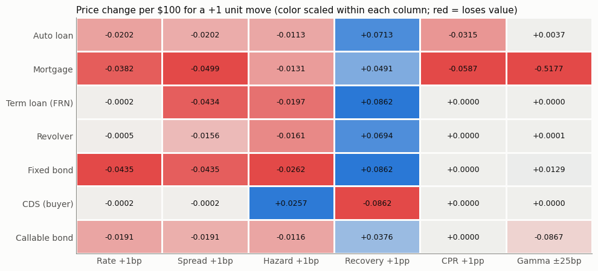
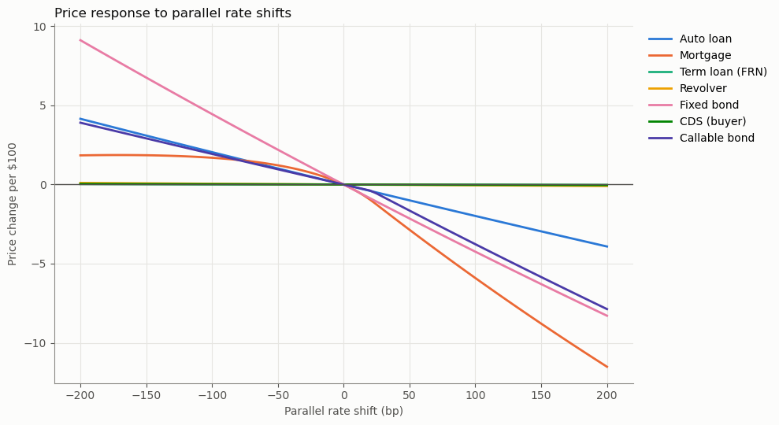
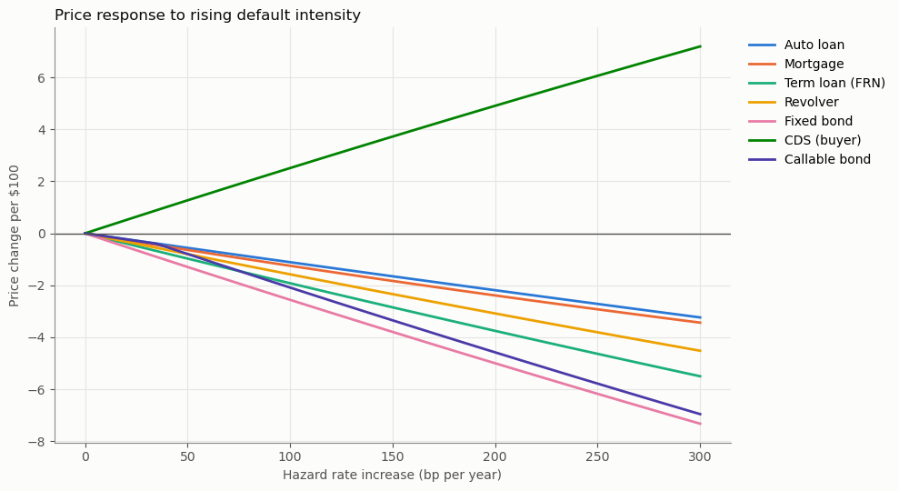

# Comparing Greeks Across Credit Instruments

The same risk factor moves credit products by very different amounts, and sometimes in opposite directions. This project prices seven instruments inside one survival-discounting framework: an amortizing auto loan, a prepayable mortgage, a floating-rate term loan, a revolver, a fixed-rate bond, a CDS and a callable bond. It then bumps each risk factor and reprices to get a common vector of Greeks for each product.



## Method

Every instrument is valued as $V_0=\sum_t D(0,t)\,[S(t)\,CF_t+q(t)\,R_t]$ on a monthly grid. Discounting uses a flat 4% risk-free curve. Survival comes from a constant hazard rate, and recovery is set per product. All instruments are sized to 100 dollars of notional, so the dollar Greeks compare directly. Each Greek is a central-difference price change for a +1 unit move in one factor:

| Factor | Bump |
|---|---|
| Rate: parallel shift of the risk-free curve, including floating coupons and the refinancing rate | +1bp |
| Spread: discount spread with cash flows held fixed (spread duration) | +1bp |
| Hazard: annual default intensity | +1bp |
| Recovery: fraction of exposure recovered at default | +1pp |
| CPR: annual prepayment rate | +1pp |
| Gamma: $P(r+25bp)+P(r-25bp)-2P(r)$ | ±25bp |

## Results (price change per 100 dollars of notional)

| Instrument | Rate +1bp | Spread +1bp | Hazard +1bp | Recovery +1pp | CPR +1pp | Gamma ±25bp |
|---|---|---|---|---|---|---|
| Auto loan | −0.0202 | −0.0202 | −0.0113 | +0.0713 | −0.0315 | +0.0037 |
| Mortgage | −0.0382 | −0.0499 | −0.0131 | +0.0491 | −0.0587 | −0.5177 |
| Term loan (FRN) | −0.0002 | −0.0434 | −0.0197 | +0.0862 | 0 | 0 |
| Revolver | −0.0005 | −0.0156 | −0.0161 | +0.0694 | 0 | +0.0001 |
| Fixed bond | −0.0435 | −0.0435 | −0.0262 | +0.0862 | 0 | +0.0129 |
| CDS (buyer) | −0.0002 | −0.0002 | +0.0257 | −0.0862 | 0 | 0 |
| Callable bond | −0.0191 | −0.0191 | −0.0116 | +0.0376 | 0 | −0.0867 |

Floating-rate structure removes rate duration but not spread duration. The term loan's rate exposure is about zero, yet its spread exposure matches the fixed bond's. The mortgage and callable bond carry negative gamma from embedded borrower and issuer options. At −200bp the fixed bond gains 9.1 while the mortgage gains only 1.8, because refinancing caps its upside. The CDS buyer mirrors a bondholder on credit: at +300bp of hazard it gains 7.19 while the bond loses 7.32.





## Run it

```bash
pip install numpy pandas matplotlib
jupyter nbconvert --to notebook --execute --inplace credit_greeks.ipynb
```

The notebook writes `greeks_table.csv`. A sanity-check cell asserts several known results. The auto loan reproduces an independent benchmark valuation, and the CDS par spread is close to $h(1-\rho)$. The floater's rate exposure is near zero. Gamma is negative for the mortgage and callable bond, and the callable never prices above its noncallable twin.

The callable bond uses a deterministic curve, so the call option has no time value and its price curve kinks rather than bends. A rate tree with an option-adjusted spread would smooth it.
